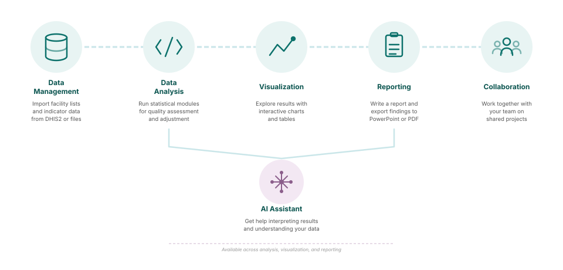

## Platform capabilities

**Data Management** — Import facility lists and indicator data from DHIS2 or files

**Data Analysis** — Run statistical modules for quality assessment and adjustment

**Visualization** — Look at any result in Explore, then build charts, maps and tables

**Sharing results** — Slide decks and narrative reports, with figures that stay linked to the data

**Collaboration** — One Products page for the team, folders, and access per product

**AI Assistant** — Get help interpreting results and understanding your data

