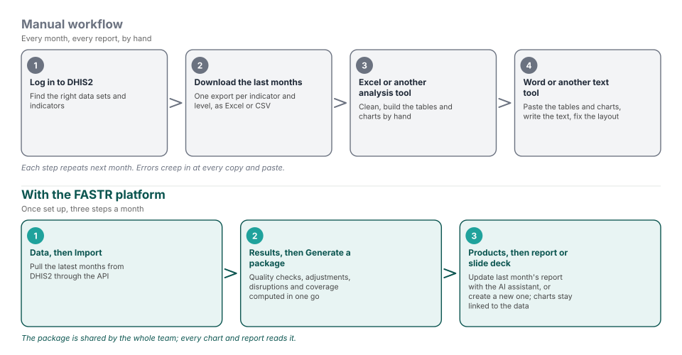

## From data to report: by hand and with FASTR

By hand, every monthly report is rebuilt from a DHIS2 export. With FASTR, a report is **linked to a results package**: it picks one when created, and a new month means switching it to the new package. Every chart refreshes; the AI assistant rewrites the text.

<!--
PRESENTER NOTES:
- The four grey steps are what most teams do today; ask the room how long one report takes.
- The three green steps are the platform flow: Data → Import, Results → Generate a results package, Products → report. Only the first two need an administrator.
- Charts in a FASTR report stay linked to the package, so updating the report is a package change, not a rebuild.
-->
