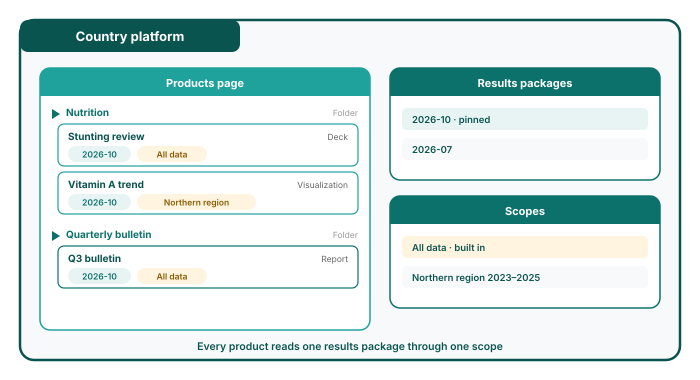

## Products, folders and scopes

One **Products** page for the country: every visualization, slide deck and report, in **folders**.

Each product reads one **results package** (which computation) through one **scope** (which part of the data).

**Key questions when setting up:**

- Which package is pinned?
- Which scopes does the team need?
- Who may open or edit what?

