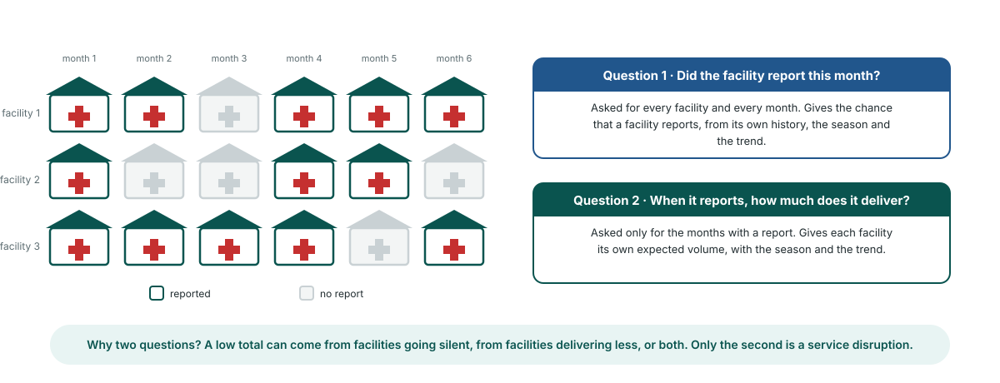

<!-- _class: output -->
## The Bayesian way: two questions per facility

**Question 1:** did this facility report this month? Asked for every facility and every month.

**Question 2:** when it reports, how much does it deliver? Asked only for the months with a report.

**Why separate them:** a low total can come from facilities going silent or from facilities delivering less. Only the second is a service disruption.

<!--
PRESENTER NOTES:
- This is the Disruption detection module (M11) in the platform. It replaced the control-chart model (M3) in 2026; the older slides are kept for reference.
- The model works facility by facility, month by month, then adds up to province and district. No separate model per area.
- Question 1 is a yes/no model of reporting. Question 2 is a count model of service volume, fitted only where a report exists.
- Each facility gets its own baseline level, so a hospital and a health post are each compared with their own history.
- Trend and season are in both questions, so a dry-season dip or a slow national rise is not called a disruption.
-->
