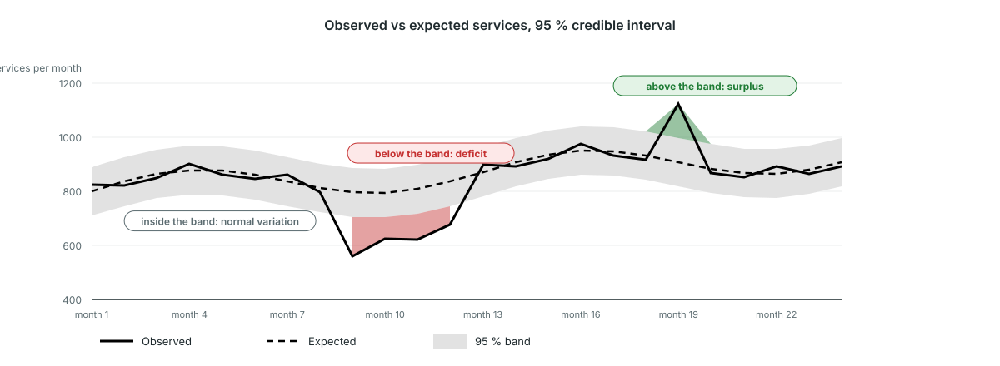

<!-- _class: output -->
## Reading the Bayesian disruptions chart

**What you see:** observed volume (solid line), expected volume (dashed line), and the 95 % credible band (grey).

**What it shows:** red where observed falls below the band, a deficit; green where it rises above, a surplus. Inside the band is normal variation.

**Interpretation:** a red stretch is a real decline among the facilities that reported. Ask what happened in those months: stock-outs, strikes, insecurity, a campaign elsewhere.

<!--
PRESENTER NOTES:
- Illustrative chart, drawn with the platform's colours. In the platform: Results packages → the disruptions chart with 95 % credible band, one panel per indicator, national or by admin area 2.
- A single red month is worth a look; several red months in a row are the pattern to act on.
- For indicators where an increase is bad (stillbirths, deaths), the colours are swapped.
- The last months can change: late reports arrive after the package is generated.
-->
