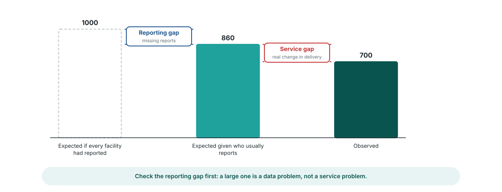

<!-- _class: output -->
## Reporting gap or service gap?

**What you see:** three bars for one area and month: what was expected if every facility had reported, what was expected given who usually reports, and what was observed.

**What it shows:** the first step down is the **reporting gap**, missing reports. The second is the **service gap**, a real change in delivery.

**Interpretation:** a large reporting gap is a data problem to fix with the facilities. A large service gap is a program question.

<!--
PRESENTER NOTES:
- These two gaps are in the module output (gap_reporting, gap_service) for every area and month, next to the observed and expected values.
- Also in the output: mean_p, the average chance of reporting in the area that month. It tracks completeness as the model sees it.
- Practical order: check the reporting gap first. If it explains most of the shortfall, go back to data quality before asking the program why services fell.
-->
