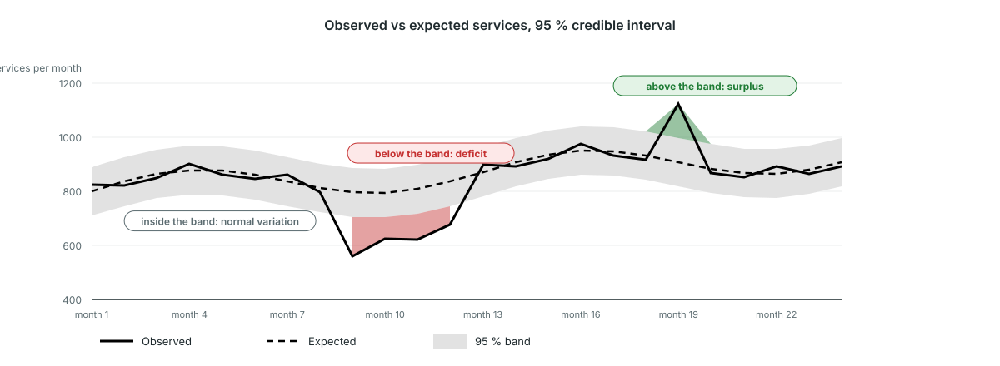

<!-- _class: output -->
## Disruption detection (Bayesian): what to look at

**What you see:** observed (solid) vs expected (dashed) with a grey 95 % band, for the facilities that reported each month.

**What it shows:** red below the band is a real deficit among reporting facilities, not missing reports. Green above is a surplus.

**Interpretation:** several red months in a row are the pattern to act on. Check the reporting gap first, then ask the program what happened.

<!--
PRESENTER NOTES:
- Condensed version of m6_2e to m6_2h. The model asks two questions per facility: did it report, and how much did it deliver when it did.
- Because expected and observed use the same facilities each month, a facility going silent does not show as a disruption.
- Module M11 in the platform; the older control-chart slides (m6_2, m6_2b, m6_2d) describe the retired M3 model.
-->
