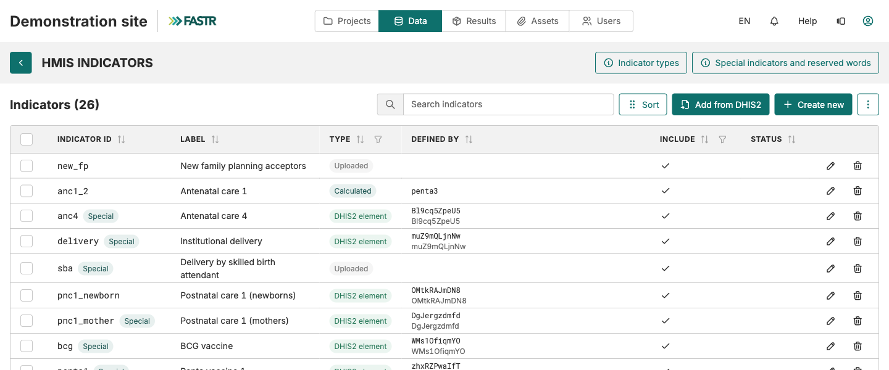

## Adding indicators: one table, four types

Your instance already holds the priority RMNCAH-N indicators. It may not hold every indicator your reports need. All indicators live in **one table**: **Data → HMIS → Indicators**.

| Type | What it is | Where its numbers come from |
|---|---|---|
| **DHIS2 element** | One DHIS2 data element or indicator | A DHIS2 import |
| **Uploaded** | Values from a CSV file | The Imports page |
| **Sum** | Other indicators added together | Computed from its members |
| **Calculated** | A formula, e.g. `anc4 / anc1` | The Indicator values module, at package generation |

**Special** rows (`anc1`, `delivery`, `bcg`…) are read by the modules by ID: fill them, do not recreate them.

