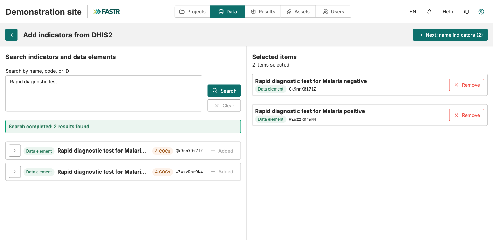

## Step 1: find the indicator in DHIS2, from inside FASTR

1. On the indicator list, click **Add from DHIS2** (top right). FASTR uses the instance's stored **DHIS2 connection**.
2. Type a word from the official DHIS2 name (`antenatal`) or paste the DHIS2 ID, then **Search**.
3. Click **Add** next to each element you want. It moves to **Selected items**. Search again if needed; the selection is kept.
4. Click **Next: name indicators (N)**.

A subgroup (an age band, a sex)? Unfold the row's chevron and add the **COC** line, not the main line. Greyed rows marked "Cannot be added" are not monthly counts.
