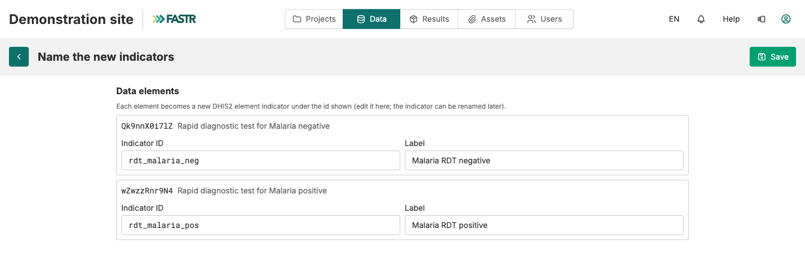

## Step 2: name, then save

FASTR proposes an ID and a label for each element from its DHIS2 name. Replace them with yours:

- **Indicator ID**: lowercase letters, digits and underscores only. For an indicator on the FASTR list, use its standard ID (`anc1`, `anc4`, `penta1`).
- **Label**: the name shown on charts. Accents and spaces are fine.

Click **Save**. Repeat steps 1 and 2 until your whole list is covered.

**Checkpoint:** each new row shows the **DHIS2 element** badge, its DHIS2 code under **Defined by**, and a tick under **Include**. No numbers have been downloaded yet.
