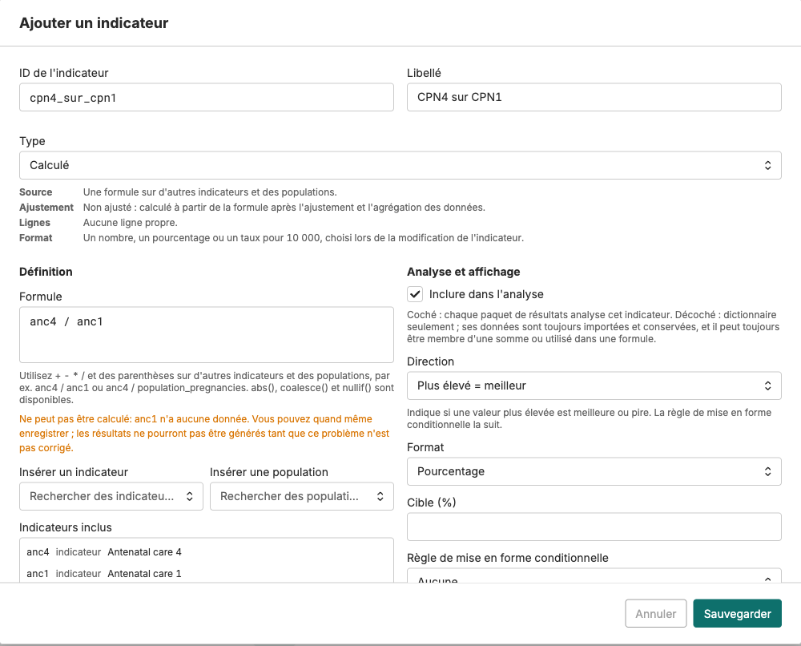

## Calculated indicators: a formula with its own rules

Click **Add indicator**, choose the type **Calculated**, and fill in:

- **Formula**: over existing indicators and population figures, e.g. `anc4 / anc1` or `anc1 / population_pregnancies`. **Insert indicator** and **Insert population** paste the right names. Population figures come from the instance **Population** page.
- **Format**: number, percent, or rate per 10,000.
- **Direction**: **Higher is better** or **Lower is better**.
- **Target** (optional) and the **Conditional formatting rule**: ascending thresholds, e.g. 70 and 80, that define the red, yellow and green bands.

A calculated indicator has no values until the **Indicator values** module runs in a results package. The rule you set here is what colors it on every scorecard.

