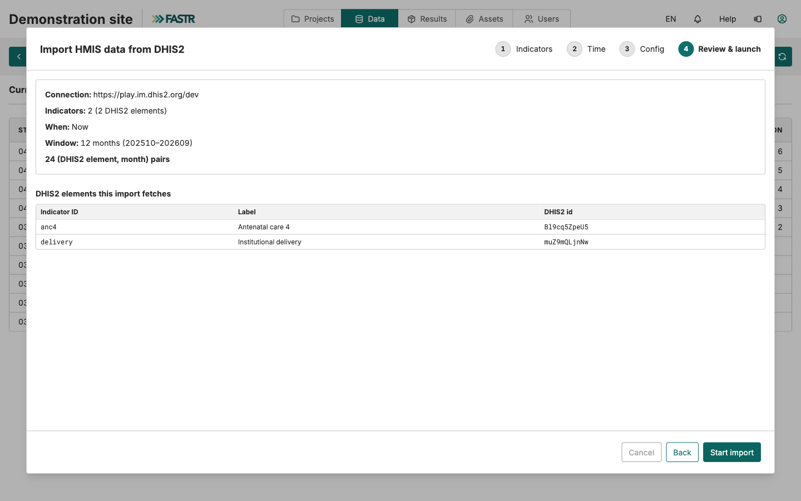

## Step 3: import the data, four steps

**Data → HMIS → Data → Imports**, then **New DHIS2 import**. The wizard uses the stored connection; there is nothing to type.

| Step | What you do |
|---|---|
| **Indicators** | Tick the indicators to fetch (the top checkbox selects all) |
| **Time** | **Now**, **Once, at a set time**, or **Recurring** |
| **Config** | The period range: starting year and month, number of months |
| **Review & launch** | Check connection, indicators, window and the number of (element, month) pairs, then **Start import** |

Since version 1.76 the review step asks DHIS2 about your selection first. It warns when an ID points to a DHIS2 formula rather than a data element, or when DHIS2 no longer knows the ID.
