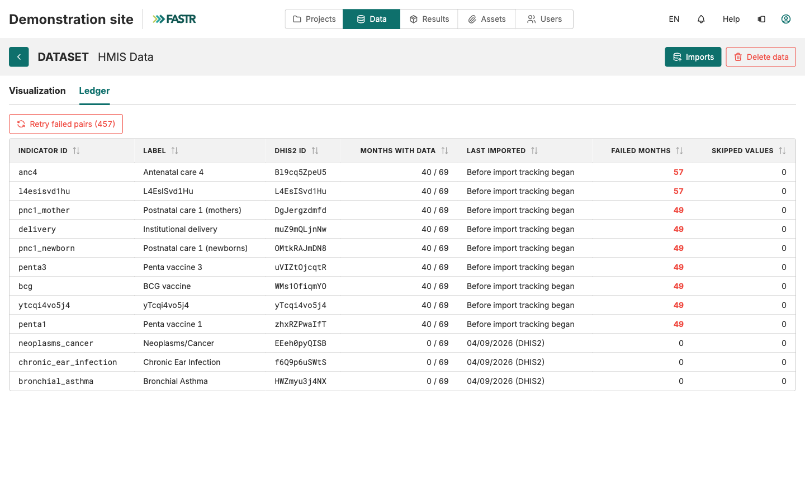

## After launch: Current, History, Ledger

The import runs **on the server**. Close the tab, work elsewhere, log off: it keeps running.

- **Current** tab: progress of the running import
- **History** tab: when it finished and how many pairs succeeded or failed
- **Ledger** tab (HMIS Data page): per indicator, the months with data, the last import, and any failed months, with a retry for just those

An import keeps everything that succeeded; nothing is rolled back. A few failures usually mean no data in DHIS2 for that month. Many failures point to the indicator mapping.

**Then:** an administrator generates a results package so projects can use the new data. Imports change the instance; projects read packages.
