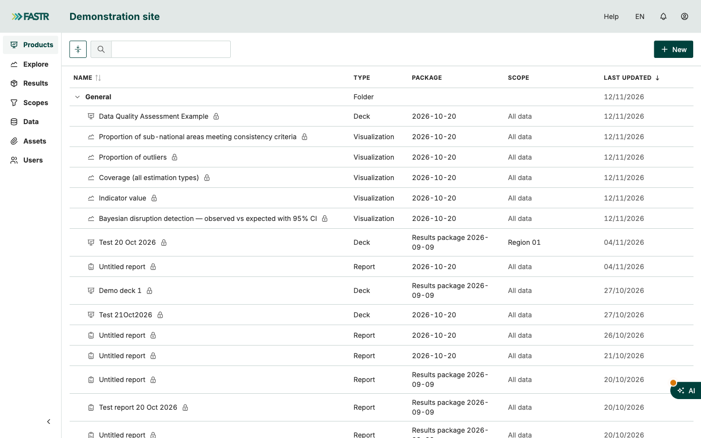

## The home screen: one Products page

**Products**: every deck, report and saved visualization in the country, in folders. Each row shows its package and its scope.

**Side navigation**:

- **Products**: where you work
- **Explore**: a quick look at any analysis, nothing to create
- **Results** and **Scopes**: where the numbers come from
- **Data**, **Assets**, **Users**: administration

<!--
PRESENTER NOTES:
- Show this live if you can; the screenshot is the fallback.
- Since 2.0 there are no projects and no dashboards: one list for the whole country, folders to keep it readable. Say it once for people who used FASTR before.
- Each product is tied to one results package and one scope, visible in its row. That is the only thing to check when numbers look old.
- The rail is collapsed by default: arrow at the bottom to expand. **New** (top right) creates a deck, a report, a visualization or a folder.
- The AI button (bottom right) works inside an open product, not on this page.
- Nothing to install. Browser, laptop, country URL.
-->
