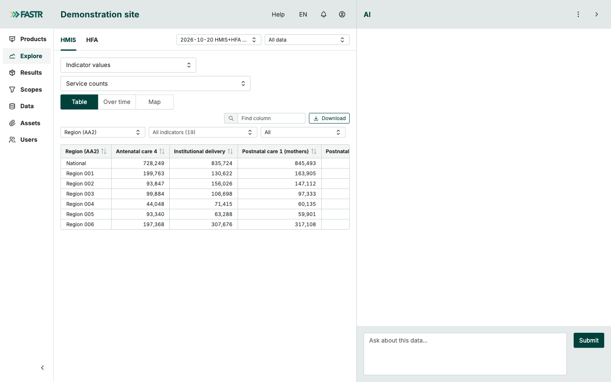

## Explore: look before you build

Explore shows every analysis already computed in a results package, with nothing to create and nothing to save.

Four controls at the top:

- **HMIS / HFA**: the data family
- **Results package** (top right): the pinned one is selected
- **Scope**: **All data** is the whole country
- **Module** and **metric** (left): opens on **Indicator values → Service counts**

<!--
PRESENTER NOTES:
- ~3 min. The point: before anyone builds a chart, they can see what the data says.
- Name the four controls on screen, in that order; the activity asks participants to name them back.
- Package and scope are the same two things every product carries. Explore uses the same ones, so numbers match.
- Change a filter and the page refreshes; nobody else sees it, nothing is kept. "Nothing can be broken" lowers the stakes for first-time users.
-->
