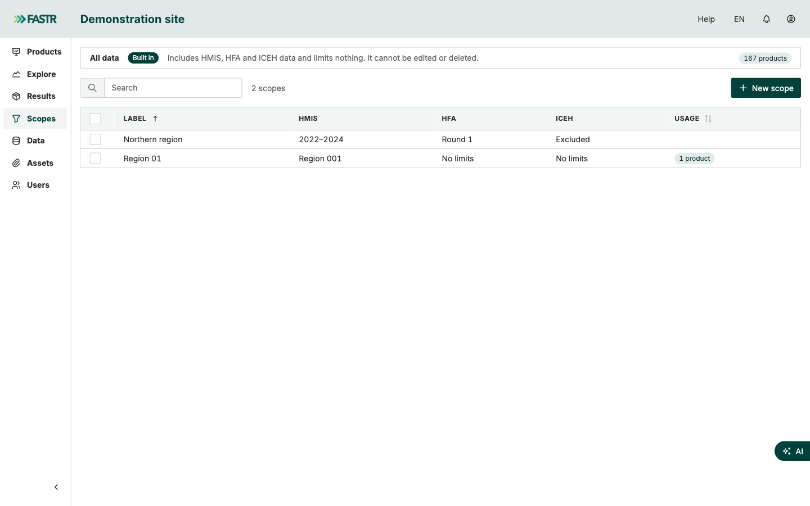

## A scope: a named slice of the data

- A **named view** of the data: one region, a range of years, a set of modules or indicators, per family (HMIS, HFA, ICEH).
- **All data** is built in: everything, nothing limited. The default for new products.
- The **Scopes** page lists each scope, what it limits, and how many products carry it.
- Package = *which computation*. Scope = *which part you look at*.

<!--
PRESENTER NOTES:
- Every approved user sees the Scopes list; only unrestricted users can change it (next slide).
- Analogy: the package is the dish, the scope is the portion served.
- Scopes replaced the restriction a project used to carry. A scope with a "Migrated" badge was created from an old project.
- Administrators can also grant a scope to a restricted user; it then bounds everything that user sees. That is a Users page topic, not this session.
- Explore and every product use the same list of scopes, so a scope is a shared vocabulary for the team.
-->
