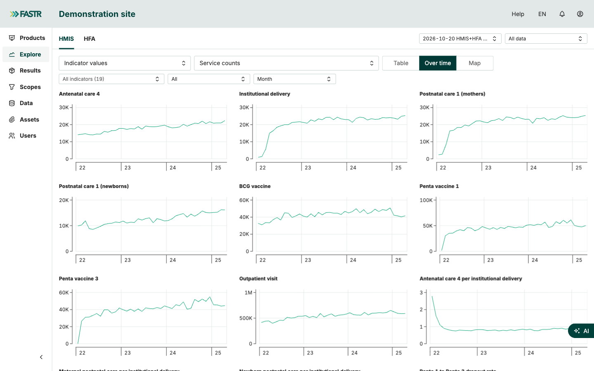

## Three views: Table, Over time, Map

- **Table**: one row per area, one column per indicator. Filters for the level, the indicators and the period. **Download** saves it as a file.
- **Over time**: one small chart per indicator, by **Month**, **Quarter** or **Year**, at the level you choose.
- **Map**: one indicator, one level, one period, colored by area. Needs the boundary files of your instance.

<!--
PRESENTER NOTES:
- Switch Table → Over time → Map once on screen. Three views of the same numbers.
- Periods: Last 12 months, Last quarter, Last year, All. Click a header to sort; Find column jumps to an indicator.
- Table is the one people download for a meeting. Over time is where disruptions show. Map needs GeoJSON boundary files; on an instance without them the page says so. Say it before someone reports a bug.
- Level labels are the country's own (region, district, sub-district).
-->
