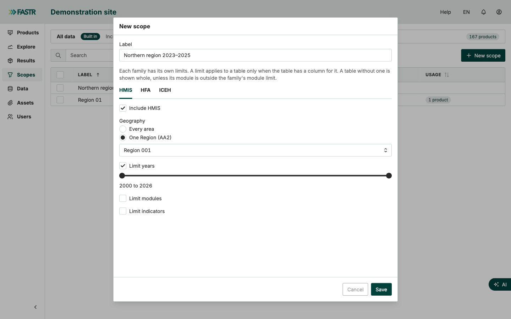

## Making a scope

- **Scopes → New scope**, then a label the team will recognize.
- One tab per family (HMIS, HFA, ICEH); untick **Include** to leave one out.
- Limits: **Geography** (one region), **years**, **modules**, **indicators**.
- **Save**. Needs unrestricted data access; everyone else only sees the list.

<!--
PRESENTER NOTES:
- HFA also limits rounds and categories. A scope a product carries cannot be deleted.
- Example label: "Northern region 2023–2025".
- Show it live if your account can: New scope, pick one region, limit the years, Save. Delete it afterwards if it is a test.
- One area per scope, at the second administrative level. For two regions, make two scopes or a product per region.
- The label "All data" is reserved in every language. Name a scope by what it contains, not by who made it or the meeting it is for.
- Delete is refused while a product carries the scope; move the product first.
-->
