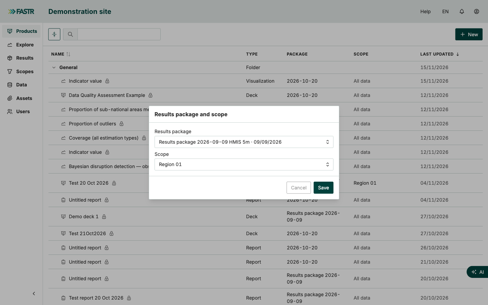

## A product carries one scope

- Every product is created with a package and a scope, shown in its row on Products.
- To change them: ⋮ → **Results package and scope…** → **Save**. Every figure refilters.
- Explore has the same two selectors, top right.
- A scope for a regional review or a period; a chart's own filters for a single chart.

<!--
PRESENTER NOTES:
- Changing a product's scope needs edit access on that product. Viewers see the row but cannot change it.
- A scope change changes the numbers in every figure of the product; titles and interpretations may need an update.
- Filter versus scope: a filter lives in one visualization; a scope applies to the whole product and to anything copied from it.
- Access is separate: a scope limits what a product shows, Manage access limits who can open it.
-->
