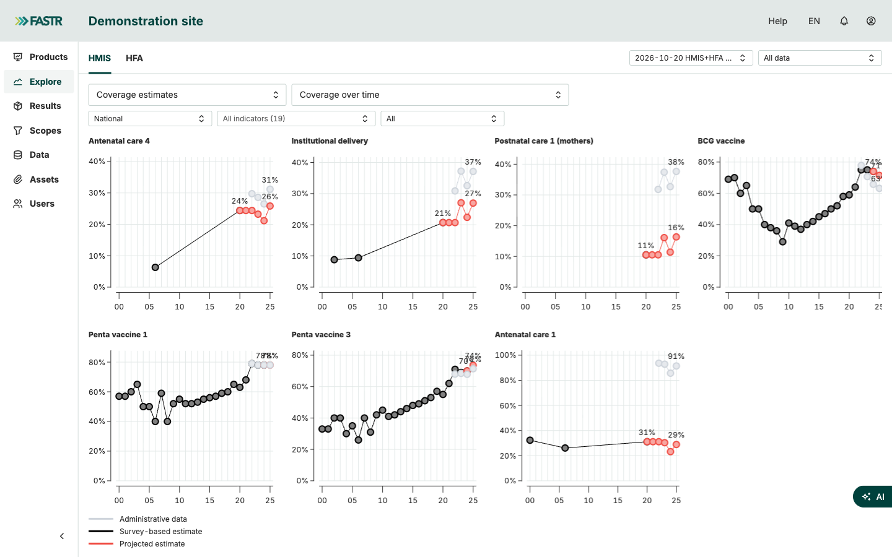

## Each module brings its own metrics

The **module** dropdown has two groups:

- **Primary results**: Indicator values
- **Supporting analyses**: Data quality assessment, Data quality adjustments, Disruption detection, Coverage denominators, Coverage estimates

Each module changes the metric list and the view. **Coverage estimates → Coverage over time** draws one chart per indicator: grey from routine data, black from surveys, red for the projection.

<!--
PRESENTER NOTES:
- Open the module dropdown on screen and read the two groups.
- Coverage chart colours are the same as in the methodology slides and in visualizations: grey HMIS, black survey, red projection.
- Disruption detection → Observed and expected services shows the expected band and the months outside it.
- Do not explain the methods here; the data quality, disruption and coverage modules each have a session.
-->
