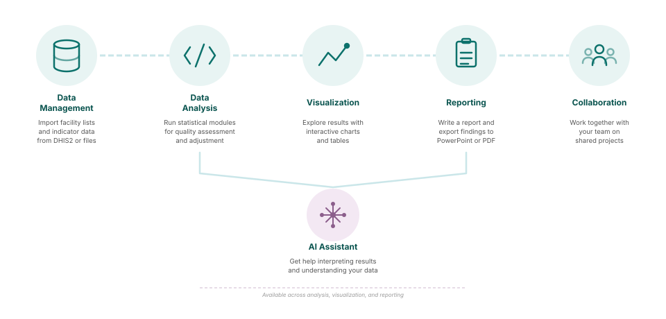

## Capacités de la plateforme

**Gestion des données** — Importez établissements et indicateurs depuis DHIS2 ou des fichiers

**Analyse des données** — Des modules statistiques, calculés en paquets de résultats

**Visualisation** — Explorer pour regarder, puis graphiques, cartes et tableaux

**Partage des résultats** — Présentations et rapports, figures liées aux données

**Collaboration** — Une page Produits pour l'équipe, des dossiers, un accès par produit

**Assistant IA** — Une aide pour interpréter les résultats et comprendre vos données

