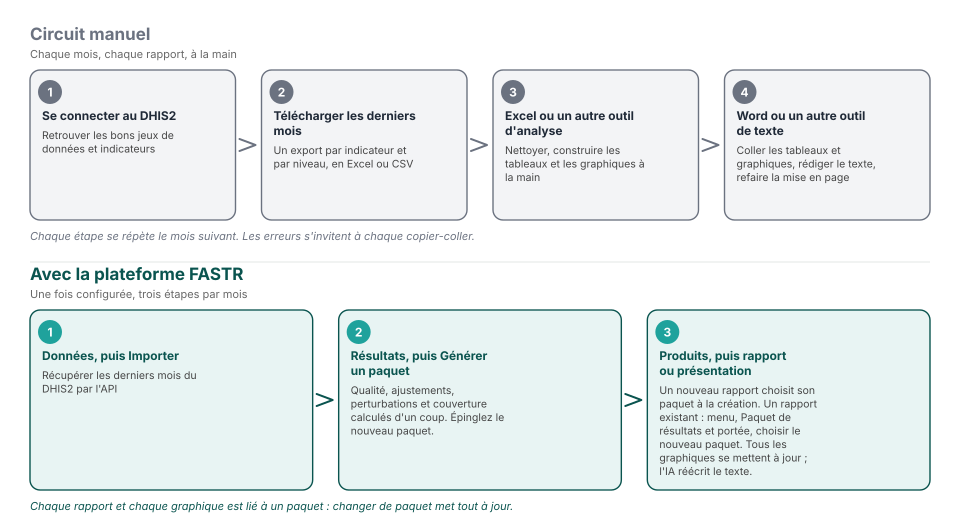

## Des données au rapport : à la main et avec FASTR

À la main, chaque rapport mensuel est reconstruit à partir d'un export DHIS2. Avec FASTR, un rapport est **lié à un paquet de résultats** : il en choisit un à sa création, et un nouveau mois revient à le faire passer sur le nouveau paquet. Tous les graphiques se mettent à jour ; l'assistant IA réécrit le texte.

<!--
PRESENTER NOTES:
- Les quatre étapes grises sont ce que la plupart des équipes font aujourd'hui ; demandez à la salle combien de temps prend un rapport.
- Les trois étapes vertes sont le circuit de la plateforme : Données → Importer, Résultats → Générer un paquet de résultats, Produits → rapport. Seules les deux premières demandent un administrateur.
- Les graphiques d'un rapport FASTR restent liés au paquet : mettre à jour le rapport, c'est changer de paquet, pas tout reconstruire.
-->
