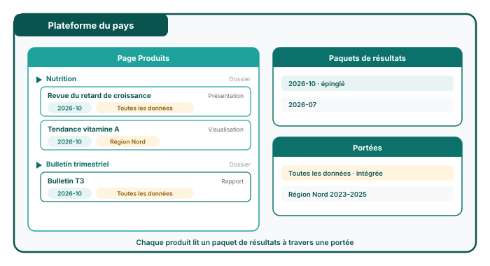

## Produits, dossiers et portées

Une seule page **Produits** pour le pays : chaque visualisation, présentation et rapport, rangés en **dossiers**.

Chaque produit lit un **paquet de résultats** (quel calcul) à travers une **portée** (quelle partie des données).

**Questions clés lors de la configuration :**

- Quel paquet est épinglé ?
- De quelles portées l'équipe a-t-elle besoin ?
- Qui peut ouvrir ou modifier quoi ?

