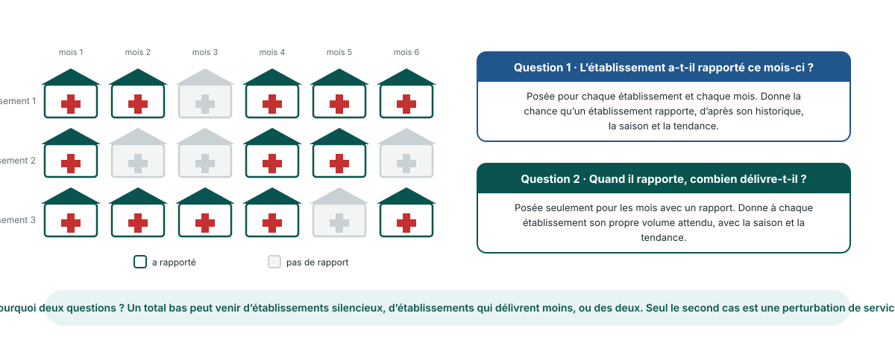

<!-- _class: output -->
## Version bayésienne : deux questions par établissement

**Question 1 :** cet établissement a-t-il rapporté ce mois-ci ? Posée pour chaque établissement et chaque mois.

**Question 2 :** quand il rapporte, combien délivre-t-il ? Posée seulement pour les mois avec un rapport.

**Pourquoi les séparer :** un total bas peut venir d'établissements silencieux ou d'établissements qui délivrent moins. Seul le second cas est une perturbation de service.

<!--
NOTES POUR LE PRÉSENTATEUR :
- C'est le module Détection des perturbations de la plateforme. Il a remplacé en 2026 l'ancien module Utilisation des services, à cartes de contrôle ; les anciennes diapositives sont gardées pour référence.
- Le modèle travaille établissement par établissement, mois par mois, puis additionne par province et district. Pas de modèle séparé par zone.
- La question 1 est un modèle oui/non du rapportage. La question 2 est un modèle de comptage du volume de services, ajusté seulement là où un rapport existe.
- Chaque établissement a son propre niveau de base : un hôpital et un poste de santé sont comparés chacun à leur propre historique.
- La tendance et la saison sont dans les deux questions : une baisse de saison sèche ou une hausse nationale lente n'est pas appelée perturbation.
-->
