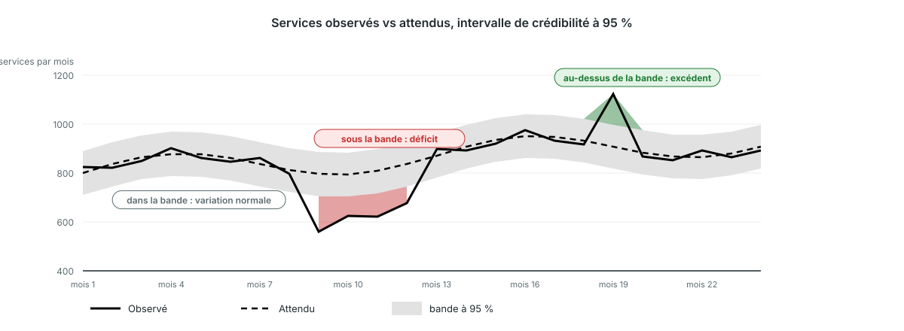

<!-- _class: output -->
## Lire le graphique bayésien des perturbations

**Ce que vous voyez :** le volume observé (ligne pleine), le volume attendu (ligne pointillée) et la bande de crédibilité à 95 % (grise).

**Ce que cela montre :** rouge là où l'observé passe sous la bande, un déficit ; vert là où il passe au-dessus, un excédent. Dans la bande, c'est la variation normale.

**Interprétation :** une plage rouge est une vraie baisse parmi les établissements qui ont rapporté. Demandez ce qui s'est passé ces mois-là : ruptures de stock, grèves, insécurité, campagne ailleurs.

<!--
NOTES POUR LE PRÉSENTATEUR :
- Graphique illustratif, dessiné avec les couleurs de la plateforme. Dans la plateforme : paquets de résultats → graphique des perturbations avec bande de crédibilité à 95 %, un panneau par indicateur, national ou par zone administrative 2.
- Un seul mois rouge mérite un regard ; plusieurs mois rouges d'affilée sont le motif sur lequel agir.
- Pour les indicateurs où une hausse est défavorable (mort-nés, décès), les couleurs sont inversées.
- Les derniers mois peuvent changer : des rapports tardifs arrivent après la génération du paquet.
-->
