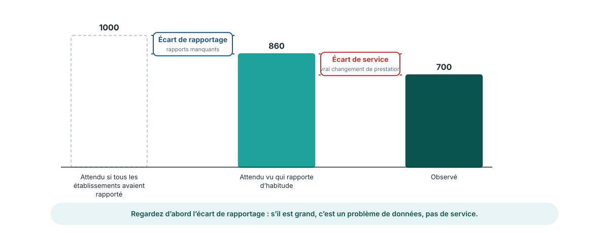

<!-- _class: output -->
## Écart de rapportage ou écart de service ?

**Ce que vous voyez :** trois barres pour une zone et un mois : l'attendu si tous les établissements avaient rapporté, l'attendu vu qui rapporte d'habitude, et l'observé.

**Ce que cela montre :** la première marche est **l'écart de rapportage**, des rapports manquants. La seconde est **l'écart de service**, un vrai changement de prestation.

**Interprétation :** un grand écart de rapportage est un problème de données à régler avec les établissements. Un grand écart de service est une question pour le programme.

<!--
NOTES POUR LE PRÉSENTATEUR :
- Ces deux écarts sont dans la sortie du module (gap_reporting, gap_service) pour chaque zone et chaque mois, à côté des valeurs observées et attendues.
- Aussi dans la sortie : mean_p, la chance moyenne de rapporter dans la zone ce mois-là. Elle suit la complétude telle que le modèle la voit.
- Ordre pratique : regardez d'abord l'écart de rapportage. S'il explique l'essentiel du manque, revenez à la qualité des données avant de demander au programme pourquoi les services ont baissé.
-->
