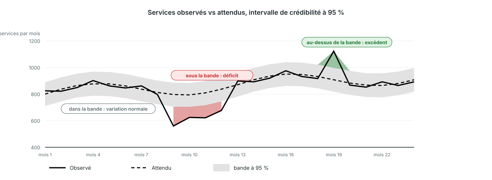

<!-- _class: output -->
## Détection des perturbations (bayésienne) : quoi regarder

**Ce que vous voyez :** observé (plein) vs attendu (pointillé) avec une bande grise à 95 %, pour les établissements qui ont rapporté chaque mois.

**Ce que cela montre :** rouge sous la bande, c'est un vrai déficit parmi les établissements rapporteurs, pas des rapports manquants. Vert au-dessus, c'est un excédent.

**Interprétation :** plusieurs mois rouges d'affilée sont le motif sur lequel agir. Regardez d'abord l'écart de rapportage, puis demandez au programme ce qui s'est passé.

<!--
NOTES POUR LE PRÉSENTATEUR :
- Version condensée de m6_2e à m6_2h. Le modèle pose deux questions par établissement : a-t-il rapporté, et combien a-t-il délivré quand il a rapporté.
- Comme l'attendu et l'observé utilisent les mêmes établissements chaque mois, un établissement devenu silencieux n'apparaît pas comme une perturbation.
- Module M11 de la plateforme ; les anciennes diapositives à cartes de contrôle (m6_2, m6_2b, m6_2d) décrivent le modèle M3 retiré.
-->
