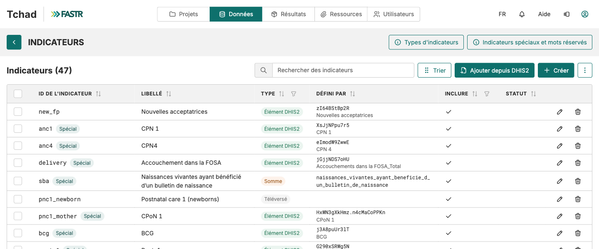

## Ajouter des indicateurs : une table, quatre types

Votre instance contient déjà les indicateurs SRMNIA-N prioritaires. Elle n'a peut-être pas tous ceux dont vos rapports ont besoin. Tous les indicateurs vivent dans **une seule table** : **Données → SNIS → Indicateurs**.

| Type | Ce que c'est | D'où viennent ses chiffres |
|---|---|---|
| **Élément DHIS2** | Un élément de données ou un indicateur DHIS2 | Une importation DHIS2 |
| **Téléversé** | Des valeurs d'un fichier CSV | La page Importations |
| **Somme** | D'autres indicateurs additionnés | Calculé à partir de ses membres |
| **Calculé** | Une formule, p. ex. `anc4 / anc1` | Le module Valeurs des indicateurs, à la génération du paquet |

Les lignes **Spécial** (`anc1`, `delivery`, `bcg`…) sont lues par les modules par leur ID : remplissez-les, ne les recréez pas.

