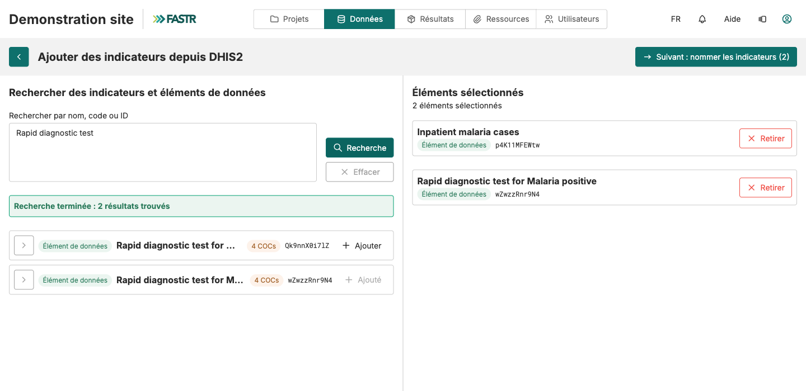

## Étape 1 : trouver l'indicateur dans DHIS2, depuis FASTR

1. Sur la liste des indicateurs, cliquez sur **Ajouter depuis DHIS2** (en haut à droite). FASTR utilise la **connexion DHIS2** enregistrée de l'instance.
2. Tapez un mot du nom officiel DHIS2 (`prénatale`) ou collez l'ID DHIS2, puis **Rechercher**.
3. Cliquez sur **Ajouter** à côté de chaque élément voulu. Il passe dans **Éléments sélectionnés**. Relancez une recherche si besoin ; la sélection est gardée.
4. Cliquez sur **Suivant : nommer les indicateurs (N)**.

Un sous-groupe (tranche d'âge, sexe) ? Dépliez le chevron de la ligne et ajoutez la ligne **COC**, pas la ligne principale. Les lignes grisées « Ne peut pas être ajouté » ne sont pas des comptages mensuels.
