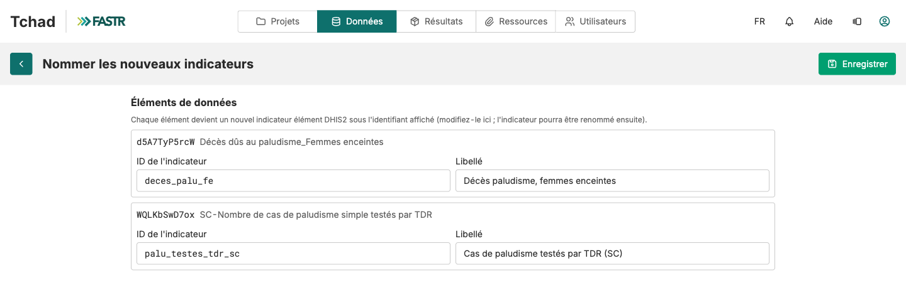

## Étape 2 : nommer, puis enregistrer

FASTR propose un ID et un libellé pour chaque élément à partir de son nom DHIS2. Remplacez-les par les vôtres :

- **ID de l'indicateur** : lettres minuscules, chiffres et tirets bas seulement. Pour un indicateur de la liste FASTR, utilisez son ID standard (`anc1`, `anc4`, `penta1`).
- **Libellé** : le nom affiché sur les graphiques. Accents et espaces acceptés.

Cliquez sur **Enregistrer**. Répétez les étapes 1 et 2 jusqu'à couvrir toute votre liste.

**Point de contrôle :** chaque nouvelle ligne montre le badge **Élément DHIS2**, son code DHIS2 sous **Défini par**, et une coche sous **Inclure**. Aucun chiffre n'a encore été téléchargé.
