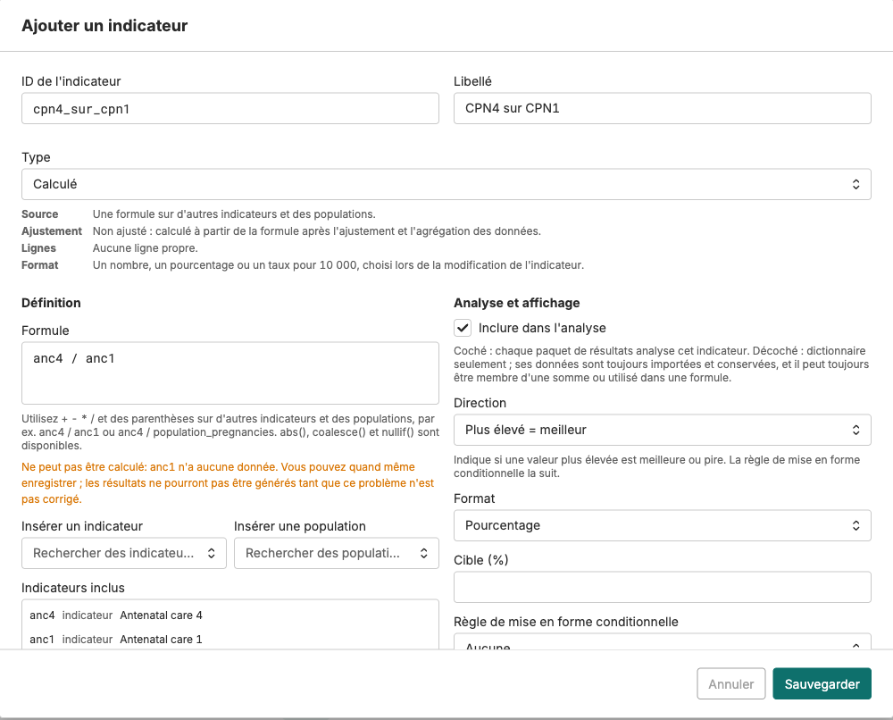

## Indicateurs calculés : une formule avec ses propres règles

Cliquez sur **Ajouter un indicateur**, choisissez le type **Calculé**, et renseignez :

- **Formule** : à partir des indicateurs existants et des chiffres de population, p. ex. `anc4 / anc1` ou `anc1 / population_pregnancies`. **Insérer un indicateur** et **Insérer une population** collent les bons noms. Les chiffres de population viennent de la page **Population** de l'instance.
- **Format** : nombre, pourcentage ou taux pour 10 000.
- **Direction** : **Plus élevé = meilleur** ou **Plus bas = meilleur**.
- **Cible** (facultative) et **Règle de mise en forme conditionnelle** : des seuils croissants, p. ex. 70 et 80, qui définissent les tranches rouge, jaune et verte.

Un indicateur calculé n'a pas de valeurs tant que le module **Valeurs des indicateurs** n'a pas tourné dans un paquet de résultats. La règle réglée ici est celle qui le colore sur chaque tableau de bord.

