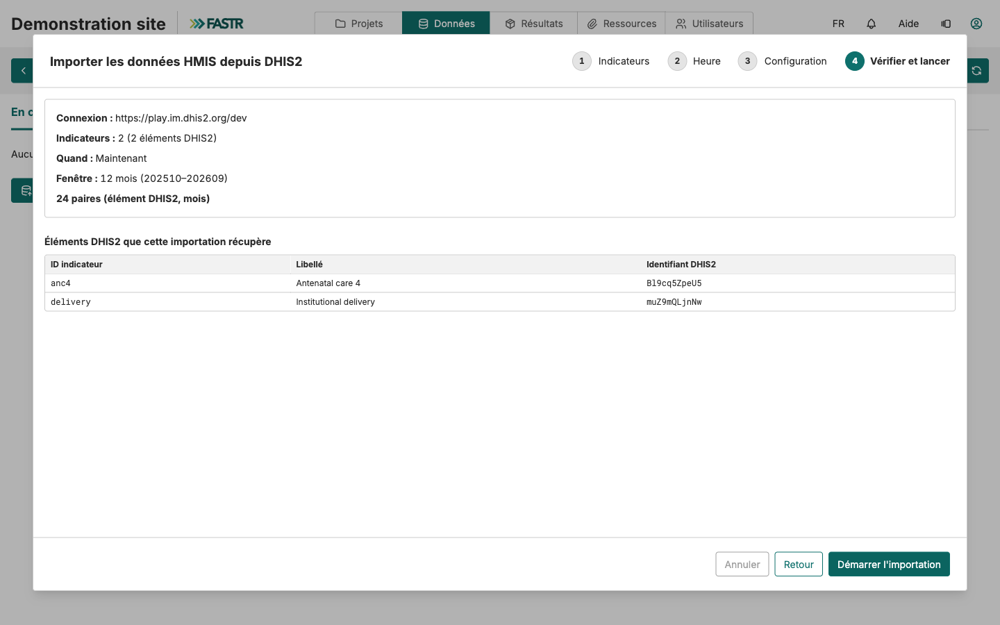

## Étape 3 : importer les données, quatre étapes

**Données → SNIS → Données → Importations**, puis **Nouvelle importation DHIS2**. L'assistant utilise la connexion enregistrée ; il n'y a rien à taper.

| Étape | Ce que vous faites |
|---|---|
| **Indicateurs** | Cochez les indicateurs à récupérer (la case du haut sélectionne tout) |
| **Heure** | **Maintenant**, **Une fois, à une heure donnée**, ou **Récurrente** |
| **Configuration** | La plage de périodes : année et mois de départ, nombre de mois |
| **Vérifier et lancer** | Vérifiez connexion, indicateurs, fenêtre et nombre de paires (élément, mois), puis **Lancer l'importation** |

Depuis la version 1.76, l'étape de vérification interroge d'abord DHIS2 sur votre sélection. Elle avertit quand un ID pointe vers une formule DHIS2 plutôt qu'un élément de données, ou quand DHIS2 ne connaît plus l'ID.
