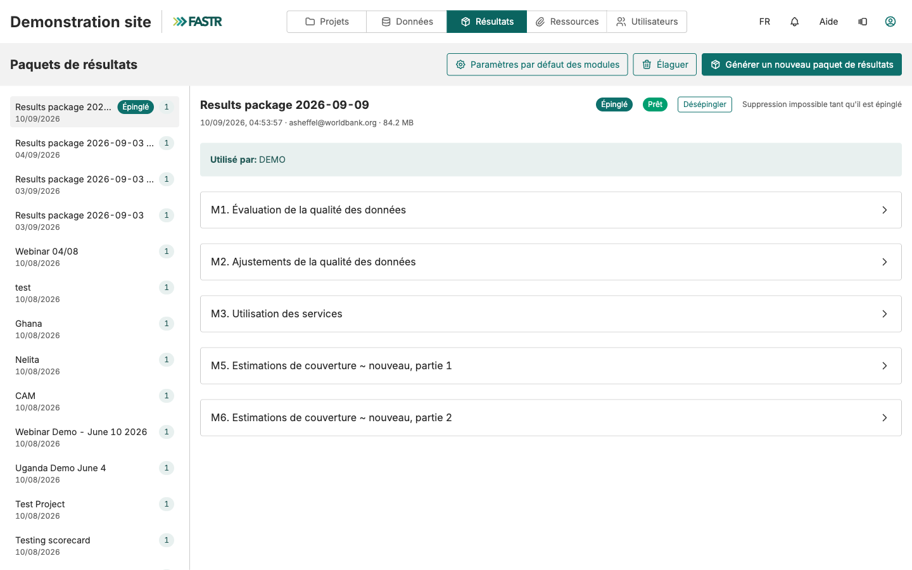

## Après le lancement : En cours, Historique, Registre

L'importation tourne **sur le serveur**. Fermez l'onglet, travaillez ailleurs, déconnectez-vous : elle continue.

- Onglet **En cours** : progression de l'importation
- Onglet **Historique** : quand elle s'est terminée et combien de paires ont réussi ou échoué
- Onglet **Registre** (page Données SNIS) : par indicateur, les mois avec données, la dernière importation et les mois en échec, avec une relance pour ceux-là seulement

Une importation garde tout ce qui a réussi ; rien n'est annulé. Quelques échecs signifient en général qu'il n'y a pas de données dans DHIS2 pour ce mois. Beaucoup d'échecs pointent vers le mappage des indicateurs.

**Ensuite :** un administrateur génère un paquet de résultats pour que les projets utilisent les nouvelles données. Les importations changent l'instance ; les projets lisent des paquets.
