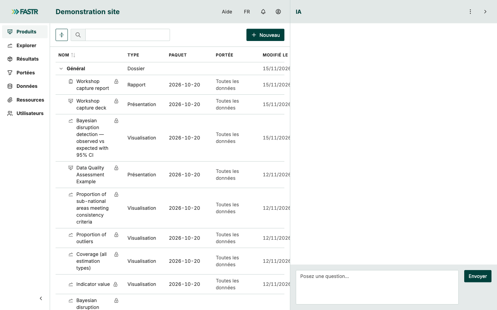

## L'écran d'accueil : une seule page Produits

**Produits** : tout ce que le pays a créé, rangé en dossiers. Chaque ligne indique son paquet et sa portée.

**Navigation latérale** :

- **Produits** : là où vous travaillez
- **Explorer** : un coup d'œil à n'importe quelle analyse, sans rien créer
- **Résultats** et **Portées** : d'où viennent les chiffres
- **Données**, **Ressources**, **Utilisateurs** : administration

<!--
PRESENTER NOTES:
- Montrez-le en direct si possible ; la capture est le plan B.
- Depuis la version 2.0, plus de projets ni de tableaux de bord : une seule liste pour tout le pays, des dossiers pour la garder lisible. Dites-le une fois pour ceux qui ont déjà utilisé FASTR.
- Chaque produit est rattaché à un paquet de résultats et à une portée, visibles dans sa ligne. C'est la seule chose à vérifier quand les chiffres semblent anciens.
- La barre est repliée par défaut : flèche en bas pour la déplier. **Nouveau** (en haut à droite) crée une présentation, un rapport, une visualisation ou un dossier.
- Le bouton IA (en bas à droite) fonctionne dans un produit ouvert, pas sur cette page.
- Rien à installer. Un navigateur, un ordinateur portable, l'URL du pays.
-->
