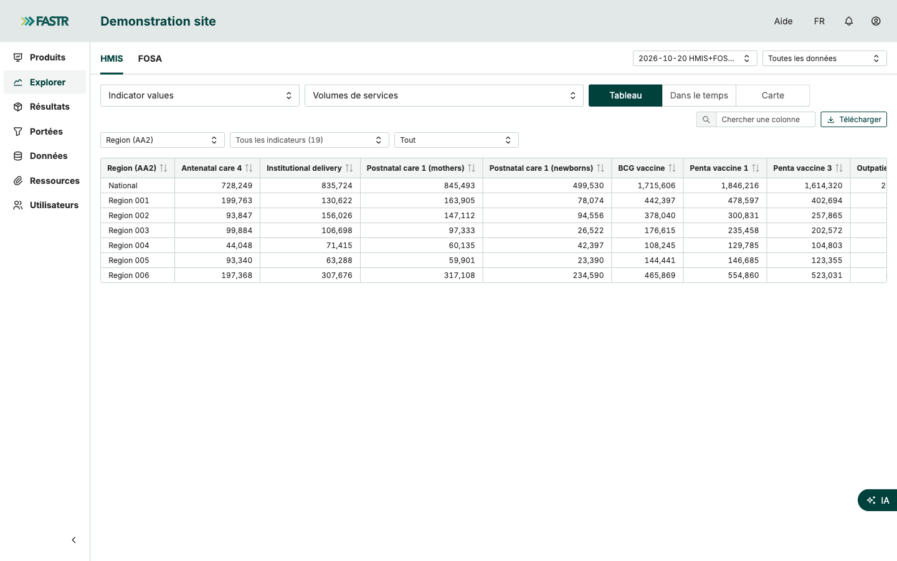

## Explorer : regarder avant de construire

Explorer montre toutes les analyses déjà calculées dans un paquet de résultats, sans rien créer et sans rien enregistrer.

Quatre contrôles en haut :

- **HMIS / FOSA** : la famille de données
- **Paquet de résultats** (en haut à droite) : celui qui est épinglé est sélectionné
- **Portée** : **Toutes les données**, c'est tout le pays
- **Module** et **métrique** (à gauche) : s'ouvre sur **Indicator values → Volumes de services**

<!--
PRESENTER NOTES:
- ~3 min. L'idée : avant de construire un graphique, on peut voir ce que disent les données.
- Nommez les quatre contrôles à l'écran, dans cet ordre ; l'activité demande aux participants de les nommer à leur tour.
- Paquet et portée sont les deux mêmes éléments que porte chaque produit. Explorer utilise les mêmes, donc les chiffres concordent.
- Changez un filtre et la page se rafraîchit ; personne d'autre ne le voit, rien n'est conservé. « Rien ne peut casser » rassure les débutants.
-->
