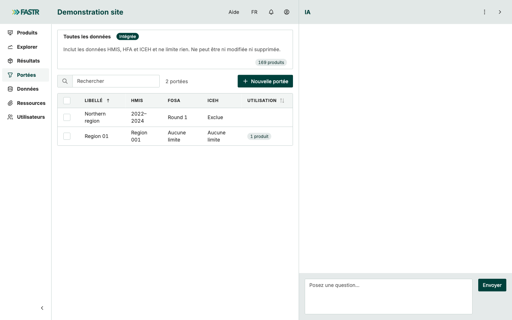

## Une portée : une tranche nommée des données

- Une **vue nommée** des données : une région, une plage d'années, des modules ou des indicateurs, par famille (HMIS, FOSA, ICEH).
- **Toutes les données** est intégrée : tout, sans limite. Le défaut des nouveaux produits.
- La page **Portées** liste chaque portée, ce qu'elle limite et combien de produits la portent.
- Paquet = *quel calcul*. Portée = *quelle partie on regarde*.

<!--
PRESENTER NOTES:
- Tout utilisateur approuvé voit la liste des portées ; seuls les utilisateurs non restreints la modifient (diapositive suivante).
- Analogie : le paquet est le plat, la portée est la portion servie.
- Les portées ont remplacé la restriction que portait un projet. Une portée avec le badge « Migrée » a été créée à partir d'un ancien projet.
- Les administrateurs peuvent aussi accorder une portée à un utilisateur restreint ; elle borne alors tout ce qu'il voit. C'est un sujet de la page Utilisateurs, pas de cette session.
- Explorer et chaque produit utilisent la même liste de portées : une portée est un vocabulaire partagé par l'équipe.
-->
