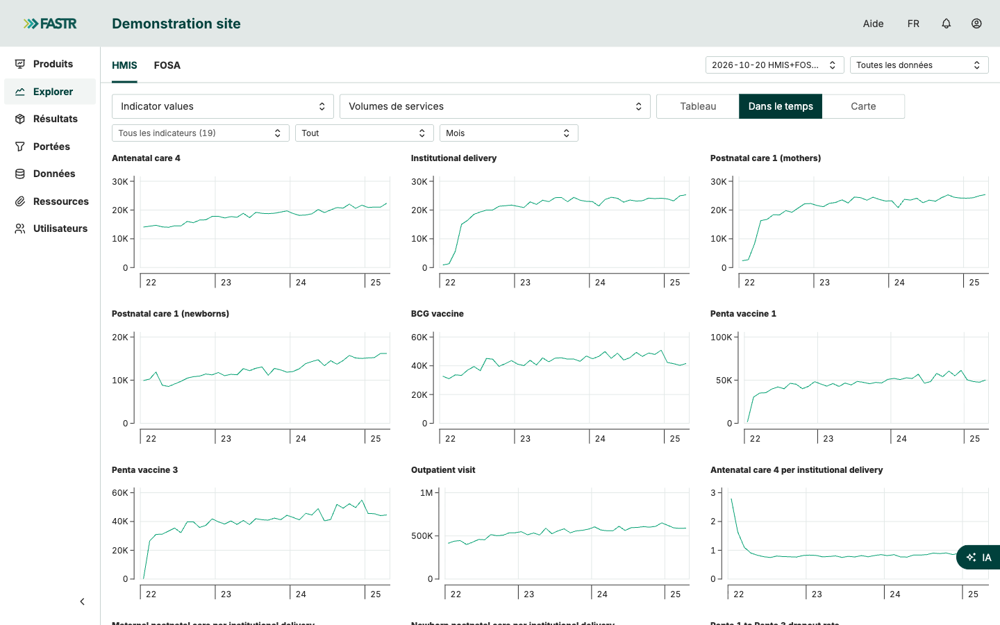

## Trois vues : Tableau, Dans le temps, Carte

- **Tableau** : une ligne par zone, une colonne par indicateur. Filtres pour le niveau, les indicateurs et la période. **Télécharger** l'enregistre dans un fichier.
- **Dans le temps** : un petit graphique par indicateur, par **Mois**, **Trimestre** ou **Année**, au niveau choisi.
- **Carte** : un indicateur, un niveau, une période, coloré par zone. Nécessite les fichiers de limites administratives de votre instance.

<!--
PRESENTER NOTES:
- Passez une fois de Tableau à Dans le temps puis à Carte à l'écran. Trois vues des mêmes chiffres.
- Périodes : 12 derniers mois, Dernier trimestre, Dernière année, Tout. Cliquez sur un en-tête pour trier ; Rechercher une colonne amène à un indicateur.
- Le tableau est celui qu'on télécharge pour une réunion. Dans le temps est là où les perturbations se voient. La carte a besoin de fichiers de limites (GeoJSON) ; sur une instance qui n'en a pas, la page le dit. Dites-le avant que quelqu'un ne signale un bug.
- Les libellés de niveau sont ceux du pays (région, district, sous-district).
-->
