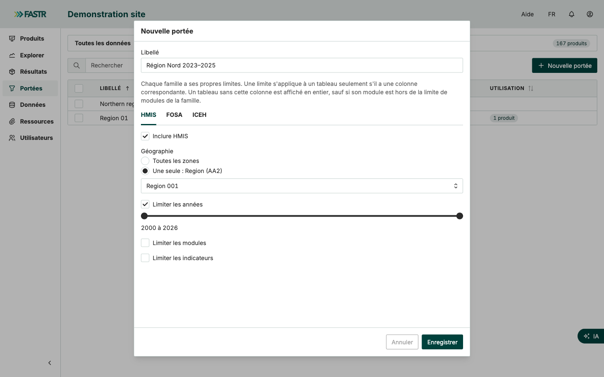

## Créer une portée

- **Portées → Nouvelle portée**, puis un libellé que l'équipe reconnaîtra.
- Un onglet par famille (HMIS, FOSA, ICEH) ; décochez **Inclure** pour en écarter une.
- Limites : **Géographie** (une région), **années**, **modules**, **indicateurs**.
- **Enregistrer**. Demande un accès non restreint aux données ; les autres voient seulement la liste.

<!--
PRESENTER NOTES:
- FOSA limite aussi les rounds et les catégories. Une portée portée par un produit ne peut pas être supprimée.
- Exemple de libellé : « Région Nord 2023–2025 ».
- Montrez-le en direct si votre compte le permet : Nouvelle portée, une région, limiter les années, Enregistrer. Supprimez-la ensuite si c'est un test.
- Une seule zone par portée, au deuxième niveau administratif. Pour deux régions, faites deux portées ou un produit par région.
- Le libellé « Toutes les données » est réservé dans toutes les langues. Nommez une portée par son contenu, pas par son auteur ni la réunion.
- La suppression est refusée tant qu'un produit porte la portée ; déplacez d'abord le produit.
-->
