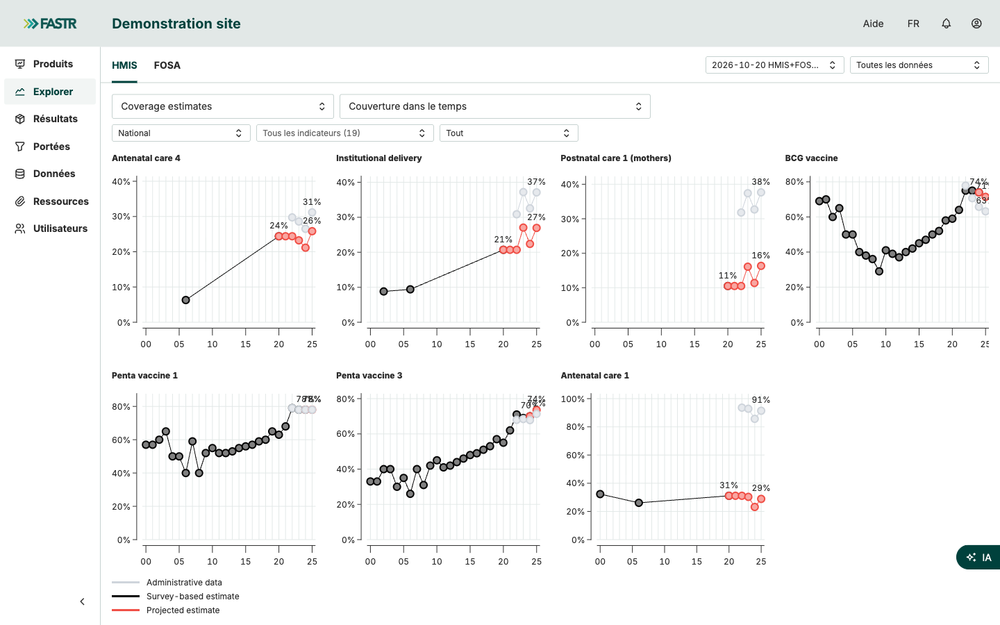

## Chaque module apporte ses propres métriques

Le menu **module** a deux groupes :

- **Résultats principaux** : Indicator values
- **Analyses complémentaires** : Data quality assessment, Data quality adjustments, Disruption detection, Coverage denominators, Coverage estimates

Chaque module change les métriques et la vue. **Coverage estimates → Coverage over time** trace un graphique par indicateur : gris à partir des données de routine, noir pour les enquêtes, rouge pour la projection.

<!--
PRESENTER NOTES:
- Ouvrez le menu des modules à l'écran et lisez les deux groupes. Les noms des modules apparaissent en anglais dans l'interface française : problème d'affichage connu.
- Les couleurs du graphique de couverture sont les mêmes que dans les diapositives de méthodologie et dans les visualisations : gris HMIS, noir enquête, rouge projection.
- Disruption detection → Observed and expected services montre la bande attendue et les mois qui en sortent.
- N'expliquez pas les méthodes ici ; les modules qualité des données, perturbations et couverture ont chacun leur session.
-->
