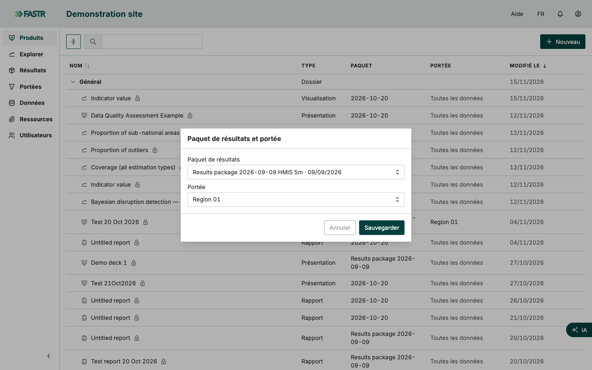

## Un produit porte une seule portée

- Chaque produit est créé avec un paquet et une portée, visibles dans sa ligne sur Produits.
- Pour les changer : ⋮ → **Paquet de résultats et portée…** → **Sauvegarder**. Chaque figure se refiltre.
- Explorer a les deux mêmes sélecteurs, en haut à droite.
- Une portée pour une revue régionale ou une période ; les filtres du graphique pour un seul graphique.

<!--
PRESENTER NOTES:
- Changer la portée d'un produit demande l'accès en modification sur ce produit. Les lecteurs voient la ligne mais ne peuvent pas la changer.
- Un changement de portée change les chiffres de toutes les figures du produit ; titres et interprétations peuvent devoir être mis à jour.
- Filtre ou portée : un filtre vit dans une visualisation ; une portée s'applique à tout le produit et à tout ce qui en est copié.
- L'accès est à part : une portée limite ce qu'un produit montre, Gérer l'accès limite qui peut l'ouvrir.
-->
