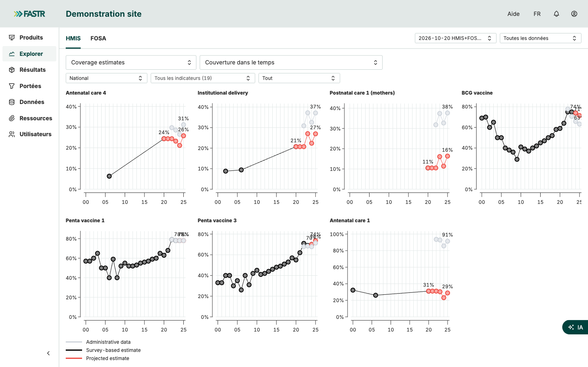

## Chaque module apporte ses propres métriques

Le menu **module** a deux groupes :

- **Résultats principaux** : Utilisation des services
- **Analyses complémentaires** : Évaluation de la qualité des données, Ajustements de la qualité des données, Détection des perturbations, Dénominateurs de couverture, Estimations de couverture

**Estimations de couverture → Couverture dans le temps** : un graphique par indicateur, gris pour la routine, noir pour les enquêtes, rouge pour la projection.

<!--
PRESENTER NOTES:
- Les couleurs du graphique de couverture sont les mêmes que dans les diapositives de méthodologie et dans les visualisations : gris HMIS, noir enquête, rouge projection.
- Détection des perturbations → Services observés et attendus montre la bande attendue et les mois qui en sortent.
- N'expliquez pas les méthodes ici ; les modules qualité des données, perturbations et couverture ont chacun leur session.
-->
