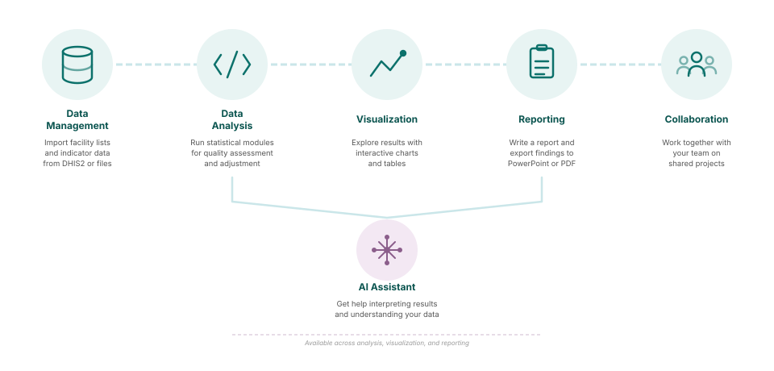

## Capacidades da plataforma

**Gestão de dados** — Importe unidades e indicadores do DHIS2 ou de ficheiros

**Análise de dados** — Módulos estatísticos, calculados em pacotes de resultados

**Visualização** — Explorar para olhar, depois gráficos, mapas e tabelas

**Partilha de resultados** — Apresentações e relatórios, figuras ligadas aos dados

**Colaboração** — Uma única página Produtos para a equipa, pastas e acesso por produto

**Assistente de IA** — Ajuda para interpretar resultados e compreender os dados

