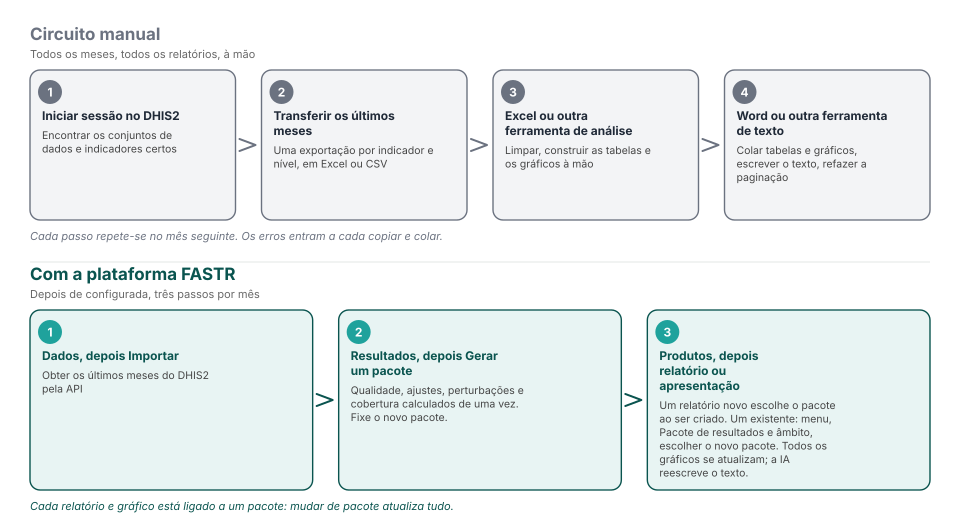

## Dos dados ao relatório: à mão e com o FASTR

À mão, cada relatório mensal é reconstruído a partir de uma exportação do DHIS2. Com o FASTR, um relatório está **ligado a um pacote de resultados**: escolhe um ao ser criado, e um mês novo é passá-lo para o novo pacote. Todos os gráficos se atualizam; o assistente de IA reescreve o texto.

<!--
PRESENTER NOTES:
- Os quatro passos cinzentos são o que a maioria das equipas faz hoje; pergunte à sala quanto tempo demora um relatório.
- Os três passos verdes são o circuito da plataforma: Dados → Importar, Resultados → Gerar um pacote de resultados, Produtos → relatório. Só os dois primeiros precisam de um administrador.
- Os gráficos de um relatório FASTR continuam ligados ao pacote: atualizar o relatório é mudar de pacote, não reconstruir tudo.
-->
