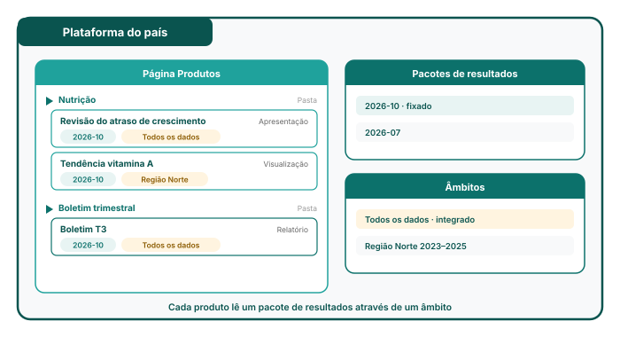

## Produtos, pastas e âmbitos

Uma única página **Produtos** para o país: todas as visualizações, apresentações e relatórios, em **pastas**.

Cada produto lê um **pacote de resultados** (que cálculo) através de um **âmbito** (que parte dos dados).

**Questões-chave ao configurar:**

- Que pacote está fixado?
- De que âmbitos a equipa precisa?
- Quem pode abrir ou editar o quê?

