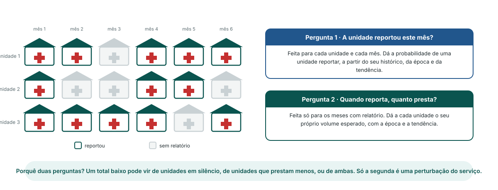

<!-- _class: output -->
## À maneira bayesiana: duas perguntas por unidade

**Pergunta 1:** esta unidade reportou este mês? Feita para cada unidade e cada mês.

**Pergunta 2:** quando reporta, quanto presta? Feita só para os meses com relatório.

**Porquê separá-las:** um total baixo pode vir de unidades em silêncio ou de unidades que prestam menos. Só a segunda é uma perturbação do serviço.

<!--
NOTAS PARA O APRESENTADOR:
- Este é o módulo Deteção de perturbações da plataforma. Substituiu em 2026 o antigo módulo de utilização de serviços, de cartas de controlo; os diapositivos antigos ficam para referência.
- O modelo trabalha unidade a unidade, mês a mês, e depois soma por província e distrito. Não há modelo separado por área.
- A pergunta 1 é um modelo sim/não do reporte. A pergunta 2 é um modelo de contagem do volume de serviços, ajustado só onde existe relatório.
- Cada unidade tem o seu próprio nível de base: um hospital e um posto de saúde são comparados cada um com o seu histórico.
- A tendência e a época estão nas duas perguntas: uma quebra na estação seca ou uma subida nacional lenta não é chamada perturbação.
-->
