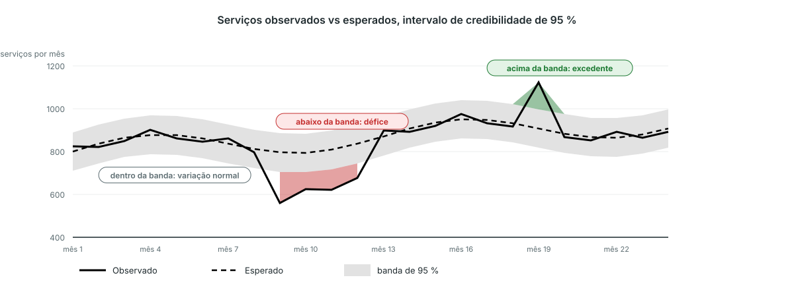

<!-- _class: output -->
## Ler o gráfico bayesiano de perturbações

**O que vê:** volume observado (linha contínua), volume esperado (linha tracejada) e a banda de credibilidade de 95 % (cinzenta).

**O que mostra:** vermelho onde o observado cai abaixo da banda, um défice; verde onde sobe acima, um excedente. Dentro da banda é variação normal.

**Interpretação:** um troço vermelho é uma quebra real entre as unidades que reportaram. Pergunte o que aconteceu nesses meses: ruturas de stock, greves, insegurança, uma campanha noutro lado.

<!--
NOTAS PARA O APRESENTADOR:
- Gráfico ilustrativo, desenhado com as cores da plataforma. Na plataforma: pacotes de resultados → gráfico de perturbações com banda de credibilidade de 95 %, um painel por indicador, nacional ou por área administrativa 2.
- Um único mês vermelho merece um olhar; vários meses vermelhos seguidos são o padrão sobre o qual agir.
- Para indicadores em que um aumento é mau (nados-mortos, óbitos), as cores trocam.
- Os últimos meses podem mudar: relatórios tardios chegam depois de o pacote ser gerado.
-->
