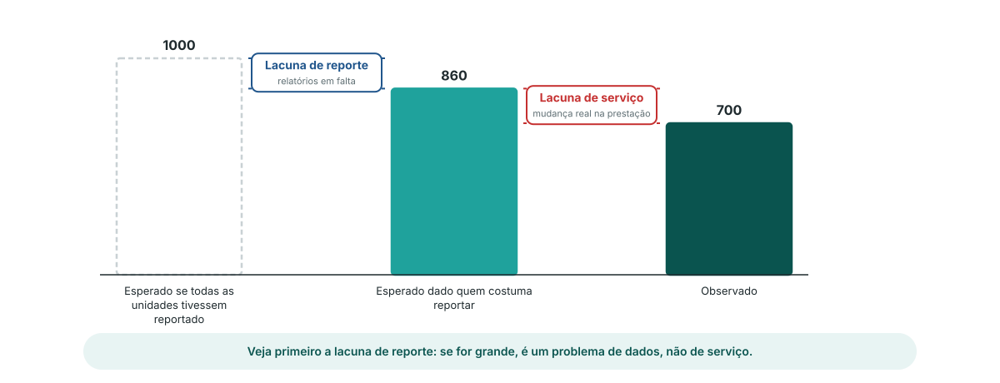

<!-- _class: output -->
## Lacuna de reporte ou lacuna de serviço?

**O que vê:** três barras para uma área e um mês: o esperado se todas as unidades tivessem reportado, o esperado dado quem costuma reportar, e o observado.

**O que mostra:** o primeiro degrau é a **lacuna de reporte**, relatórios em falta. O segundo é a **lacuna de serviço**, uma mudança real na prestação.

**Interpretação:** uma grande lacuna de reporte é um problema de dados a resolver com as unidades. Uma grande lacuna de serviço é uma questão para o programa.

<!--
NOTAS PARA O APRESENTADOR:
- Estas duas lacunas estão na saída do módulo (gap_reporting, gap_service) para cada área e mês, ao lado dos valores observados e esperados.
- Também na saída: mean_p, a probabilidade média de reportar na área nesse mês. Acompanha a completude tal como o modelo a vê.
- Ordem prática: veja primeiro a lacuna de reporte. Se explica a maior parte da quebra, volte à qualidade dos dados antes de perguntar ao programa porque é que os serviços caíram.
-->
