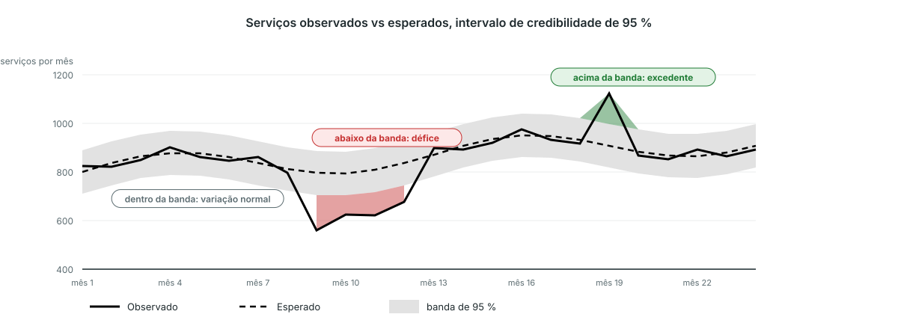

<!-- _class: output -->
## Deteção de perturbações (bayesiana): o que olhar

**O que vê:** observado (contínuo) vs esperado (tracejado) com uma banda cinzenta de 95 %, para as unidades que reportaram em cada mês.

**O que mostra:** vermelho abaixo da banda é um défice real entre as unidades que reportam, não relatórios em falta. Verde acima é um excedente.

**Interpretação:** vários meses vermelhos seguidos são o padrão sobre o qual agir. Veja primeiro a lacuna de reporte, depois pergunte ao programa o que aconteceu.

<!--
NOTAS PARA O APRESENTADOR:
- Versão condensada de m6_2e a m6_2h. O modelo faz duas perguntas por unidade: reportou, e quanto prestou quando reportou.
- Como o esperado e o observado usam as mesmas unidades em cada mês, uma unidade em silêncio não aparece como perturbação.
- Módulo M11 da plataforma; os diapositivos antigos de cartas de controlo (m6_2, m6_2b, m6_2d) descrevem o modelo M3 retirado.
-->
