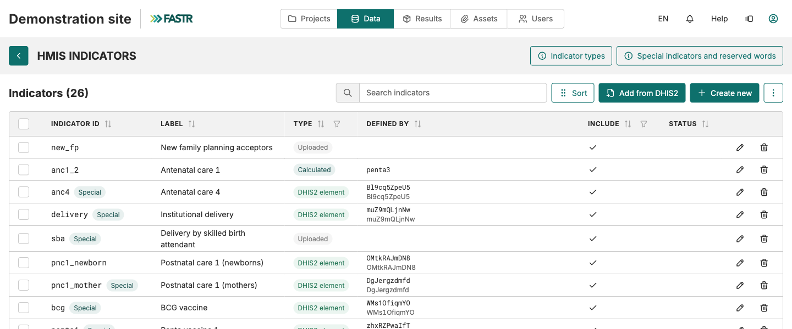

## Adicionar indicadores: uma tabela, quatro tipos

A sua instância já contém os indicadores RMNCAH-N prioritários. Pode não ter todos os que os seus relatórios precisam. Todos os indicadores vivem numa **única tabela**: **Dados → HMIS → Indicadores**.

| Tipo | O que é | De onde vêm os números |
|---|---|---|
| **Elemento DHIS2** | Um elemento de dados ou indicador do DHIS2 | Uma importação DHIS2 |
| **Carregado** | Valores de um ficheiro CSV | A página Importações |
| **Soma** | Outros indicadores somados | Calculado a partir dos membros |
| **Calculado** | Uma fórmula, p. ex. `anc4 / anc1` | O módulo Valores dos indicadores, na geração do pacote |

As linhas **Especial** (`anc1`, `delivery`, `bcg`…) são lidas pelos módulos pelo ID: preencha-as, não as recrie.

