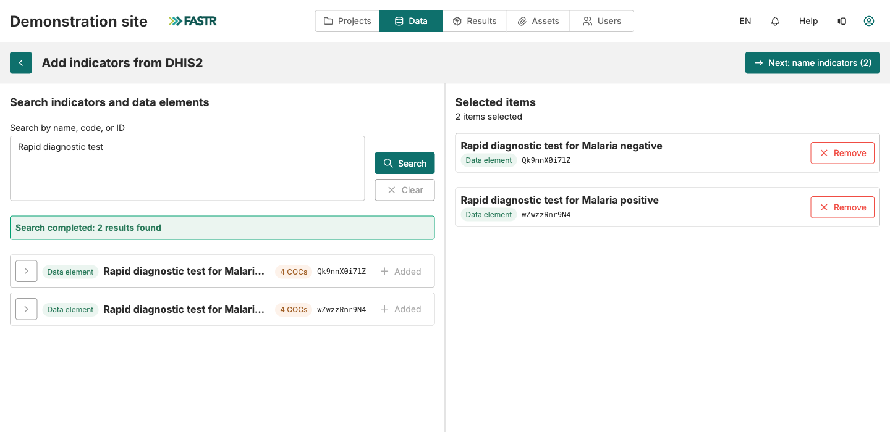

## Passo 1: encontrar o indicador no DHIS2, a partir do FASTR

1. Na lista de indicadores, clique em **Adicionar do DHIS2** (canto superior direito). O FASTR usa a **ligação DHIS2** guardada da instância.
2. Escreva uma palavra do nome oficial no DHIS2 (`antenatal`) ou cole o ID DHIS2, depois **Pesquisar**.
3. Clique em **Adicionar** ao lado de cada elemento que quer. Passa para **Itens selecionados**. Pesquise de novo se precisar; a seleção mantém-se.
4. Clique em **Seguinte: nomear indicadores (N)**.

Um subgrupo (faixa etária, sexo)? Abra a seta da linha e adicione a linha **COC**, não a linha principal. As linhas a cinzento «Não pode ser adicionado» não são contagens mensais.
